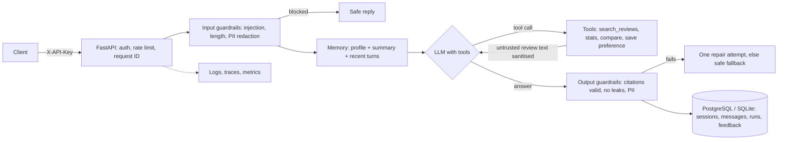

# Review Insights Agent

An AI agent that answers software buyers' questions from user reviews, cites the reviews behind every
claim, and refuses to guess. Built as a production service: FastAPI, LangChain tool calling, layered
guardrails, conversation memory, evaluation suites with a CI quality gate, and full observability
(structured logs, OpenTelemetry traces, Prometheus metrics, alert rules).

Runs on **NVIDIA Nemotron 3 Super** (`nvidia/nemotron-3-super-120b-a12b`) through NVIDIA's free hosted,
OpenAI-compatible API by default. One setting switches to OpenAI, Anthropic, Gemini or OpenRouter.

Example request and response (abridged):

```text
POST /v1/chat  {"message": "We're a 12-person sales team. Does Corvane support SSO?"}

{"status": "answered",
 "answer": "SSO with Okta is only on the Enterprise plan, which made the real price higher than the first quote [R007]. ...",
 "citations": [{"review_id": "R007", "product": "Corvane CRM", "rating": 3, ...}],
 "usage": {"input_tokens": 1293, "output_tokens": 118, "cost_usd": 0.0},
 "guardrail_flags": ["review_injection_removed"]}
```

## How a request flows



## What is inside

| Area | Where | What it does |
|---|---|---|
| Agent loop | `src/review_agent/agent/` | Tool-calling loop with step, tool-call and size budgets; one automatic repair; provider factory for NVIDIA Nemotron (default), OpenAI, Anthropic, Gemini, OpenRouter |
| Tools | `src/review_agent/tools/` | Five typed tools; errors returned as data; read-only except one scoped memory write |
| Retrieval | `src/review_agent/retrieval/` | BM25 keyword search over reviews with product and rating filters |
| Guardrails | `src/review_agent/guardrails/` | Input checks, untrusted-content sanitising, output citation checks, PII and secret redaction, prompt-leak canary |
| Memory | `src/review_agent/memory/` | Recent turns, rolling LLM summary past a token budget, structured buyer profile |
| Observability | `src/review_agent/observability/` | JSON logs with request/trace IDs, OpenTelemetry spans (GenAI conventions), Prometheus metrics, cost tracking |
| API | `src/review_agent/api/` | Chat, sessions, feedback, admin import and run review, health, readiness, metrics |
| Storage | `src/review_agent/storage/` | SQLAlchemy models and one repository for all database access |
| Ingestion | `src/review_agent/ingestion/` | Validates, de-duplicates and cleans reviews before indexing |
| Evals | `evals/` | Retrieval, guardrail and end-to-end agent suites, LLM judge, thresholds that fail CI |
| Deploy | `Dockerfile`, `docker-compose.yml`, `deploy/` | Non-root image, Postgres + Jaeger + Prometheus stack, alert rules |

Each area is explained in plain language in [`docs/`](docs/).

## Quick start

Python 3.11 or newer.

```powershell
# Windows (PowerShell)
python -m venv .venv
.venv\Scripts\activate
pip install -e ".[dev]"
copy .env.example .env      # then add NVIDIA_API_KEY (free at build.nvidia.com), or set RIA_LLM_PROVIDER=offline
uvicorn review_agent.api.main:app --reload
```

```bash
# macOS / Linux
python -m venv .venv && source .venv/bin/activate
pip install -e ".[dev]"
cp .env.example .env         # then add NVIDIA_API_KEY
uvicorn review_agent.api.main:app --reload
```

Open http://localhost:8000 for the chat page (API docs are at /docs). With no `RIA_API_KEYS` set in dev, requests need no key.

```bash
curl -s localhost:8000/v1/chat -H "Content-Type: application/json" \
  -d '{"message": "Which help desk works well with WhatsApp?"}'
```

`RIA_LLM_PROVIDER=offline` runs a deterministic rule-based stand-in for the LLM. It exercises the whole
pipeline without a key, and production refuses to start with it.

## API

| Method | Path | Purpose |
|---|---|---|
| POST | `/v1/chat` | Ask a question; pass `session_id` to continue a conversation |
| GET | `/v1/sessions/{id}` | Messages, summary and saved buyer profile |
| DELETE | `/v1/sessions/{id}` | Erase a conversation and its profile |
| POST | `/v1/feedback` | Thumbs up/down on an answer (`request_id`, `score` = 1 or -1) |
| POST | `/v1/admin/reviews/import` | Import products and reviews (`X-Admin-Key`), then rebuild the index |
| GET | `/v1/admin/runs?flagged_only=true` | Review queue of fallbacks, blocks and failed checks |
| GET | `/healthz`, `/readyz`, `/metrics` | Liveness, readiness (database), Prometheus metrics |

Errors always look like `{"error": {"code", "message", "request_id"}}`. Every response carries `X-Request-ID`.

## Evals

```bash
python -m evals.run                                         # all suites, offline model, gate on thresholds
python -m evals.run --suite agent --model configured --judge  # your real model, graded by an LLM judge
```

Latest offline run (`evals/thresholds.json` holds the gate):

| Suite | Cases | Result |
|---|---|---|
| Retrieval | 36 labelled questions | recall@5 0.99, MRR 0.98 |
| Guardrails | 20 attacks, 20 look-alike benign questions, 5 PII, 5 poisoned reviews | 18/20 attacks blocked, 20/20 benign allowed, 5/5 PII redacted, 5/5 poisoned reviews cleaned |
| Agent (offline stand-in) | 18 end-to-end cases | 17/18 pass; tool choice, citation validity, refusals and safety all 100% |

The two missed attacks are paraphrases with no trigger words ("the rules you were given no longer apply").
They stay in the set on purpose: they show the limit of pattern matching, and the other layers
(untrusted-content handling, least-privilege tools, output checks) still apply. The sample data is
5 fictional products and 50 synthetic reviews written for development, so these scores measure the
pipeline, not a production corpus. Run the agent suite with `--model configured --judge` for model-quality numbers.

## Observability

- **Logs**: one JSON line per event with `request_id`, `session_id` and `trace_id`. Message text is never logged.
- **Traces**: `agent.run` → `guardrails.input` → `llm.call` (model, tokens) → `tool.<name>` → `guardrails.output`.
  `RIA_OTEL_EXPORTER=otlp` sends them to any OpenTelemetry backend; `LANGSMITH_TRACING=true` adds LangSmith.
- **Metrics** at `/metrics`: latency, steps, tokens, cost, tool outcomes, guardrail events, grounded-answer rate, feedback.
- **Alerts** in `deploy/alerts.yml`: error rate, p95 latency, ungrounded-answer rate, injection spikes, daily spend.
- **Run records**: every request is stored in `agent_runs` for trace review and growing the eval set.

## Deploy

```bash
docker compose up --build    # API + PostgreSQL + Jaeger (http://localhost:16686) + Prometheus (http://localhost:9090)
```

The image runs as a non-root user with one Uvicorn worker per container; scale with replicas.
With `RIA_ENV=prod` the service refuses to start without API keys or with the offline model.

## Tests

```bash
ruff check . && pytest --cov=review_agent
```

60 tests (95% coverage) cover guardrails, search, ingestion, tools, memory, the agent loop with a scripted
model (repairs, fallbacks, budgets, outages, session isolation, traces), the HTTP API and the eval gate.
CI runs lint, tests and the offline evals on every push, and the real-model evals on demand.

## Design choices and limits

- **BM25, not embeddings**: buyer questions are full of exact terms (product names, "SSO", "Tally"), keyword
  search handles them well, costs nothing per query and is easy to explain. A vector index can sit behind the same interface.
- **Guardrails in code, not only in the prompt**: the prompt asks for citations; the output check enforces them.
- **In-process state**: the search index and rate-limit buckets live in each process, so the image runs one
  worker per container. For many replicas, move rate limiting to Redis. Add Alembic for schema migrations.
- **Nemotron with thinking off**: Nemotron 3 reasons by default; the service turns it off
  (`RIA_LLM_REASONING=false`) for fast tool-calling turns, and strips any `<think>` text that still appears.
  The free tier is rate-limited, so the client retries with backoff (`RIA_LLM_MAX_RETRIES`).
- **Pattern-based injection detection** is fast and free but misses paraphrases; a classifier model is the next layer to add.

## License

MIT
